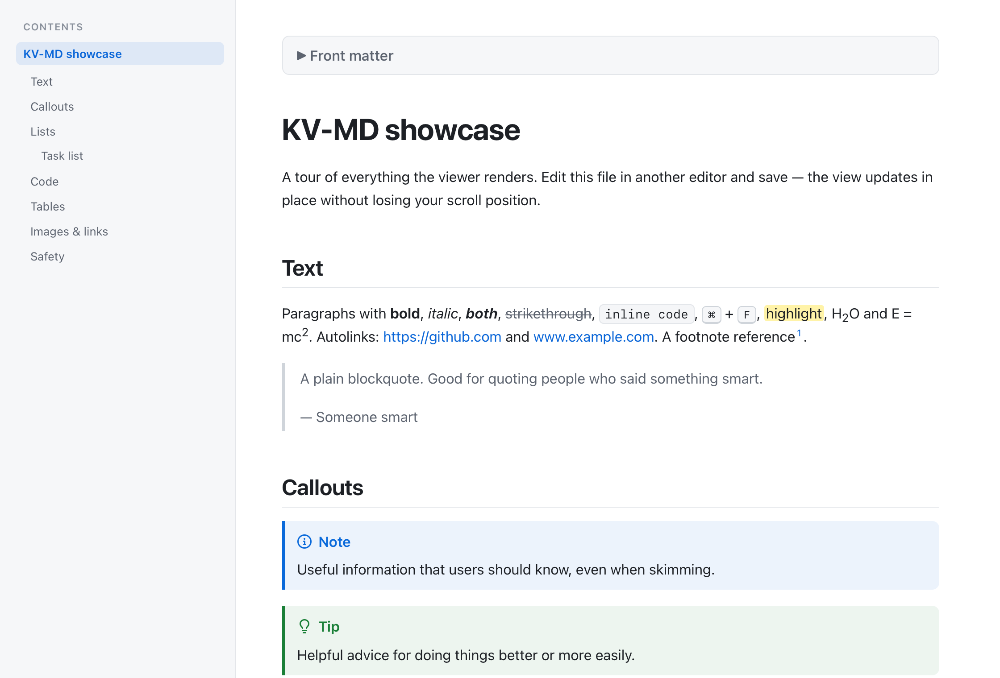
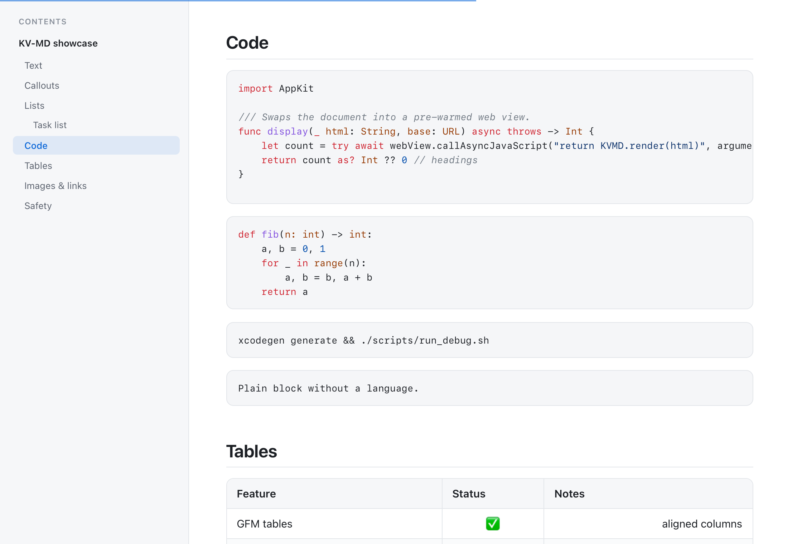
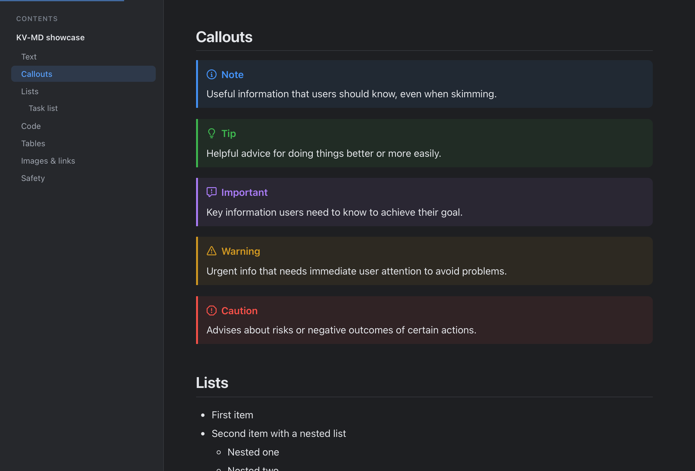

# KV-MD

A fast, lightweight Markdown viewer for macOS.

KV-MD opens `.md` files instantly and renders them beautifully — without the weight of an editor, an Electron runtime or a notes database. Double-click a file in Finder and read.

| Syntax highlighting | Dark mode |
|---|---|
|  |  |

## Features

- **Instant** — Markdown is parsed natively by GitHub's `cmark-gfm` in milliseconds and shown in a pre-warmed view. Even multi-megabyte files paint their first screen in ~100 ms.
- **GitHub Flavored Markdown** — tables, task lists, strikethrough, autolinks, footnotes, front matter.
- **GitHub alerts** — `> [!NOTE]`, `[!TIP]`, `[!IMPORTANT]`, `[!WARNING]`, `[!CAUTION]` render as callouts.
- **Syntax highlighting** for ~35 languages, with a one-click Copy button on every code block.
- **Table of contents** sidebar that follows your scroll position (⌥⌘S).
- **Live reload** — edit the file in any editor; the view updates in place and keeps your scroll position.
- **Light & dark** — follows the system appearance.
- Find (⌘F), zoom (⌘+ / ⌘− / ⌘0), print / save as PDF (⌘P), local images and relative links between documents.

## Install

Download [KV-MD.dmg](KV-MD.dmg), open it, drag **KV-MD** to Applications.

To make it the default viewer: right-click any `.md` file in Finder → **Get Info** → **Open with: KV-MD** → **Change All…**

Requires macOS 13 Ventura or later. Universal (Apple Silicon and Intel).

## Privacy

KV-MD has no accounts, analytics or telemetry. See [PRIVACY.md](PRIVACY.md).

## Credits

- [cmark-gfm](https://github.com/github/cmark-gfm) — BSD-2-Clause
- [highlight.js](https://highlightjs.org) — BSD-3-Clause

© 2026 Viacheslav Konashkov
